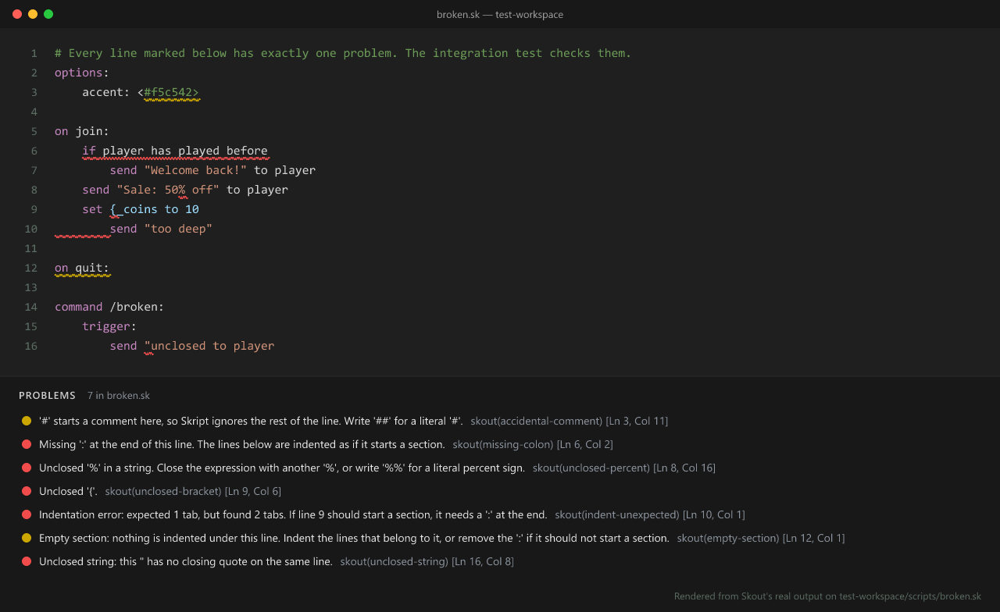
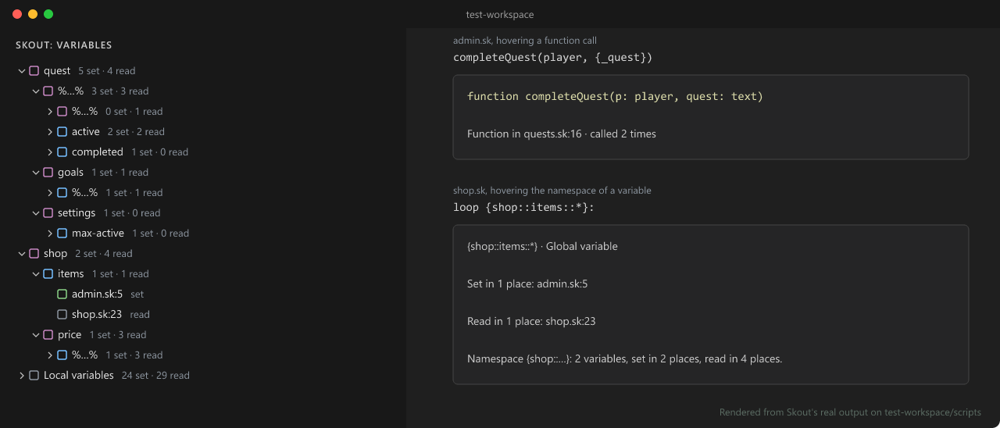
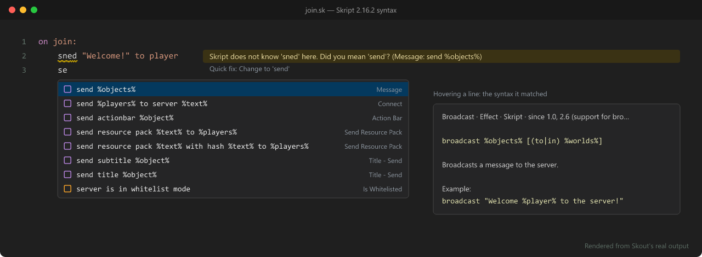
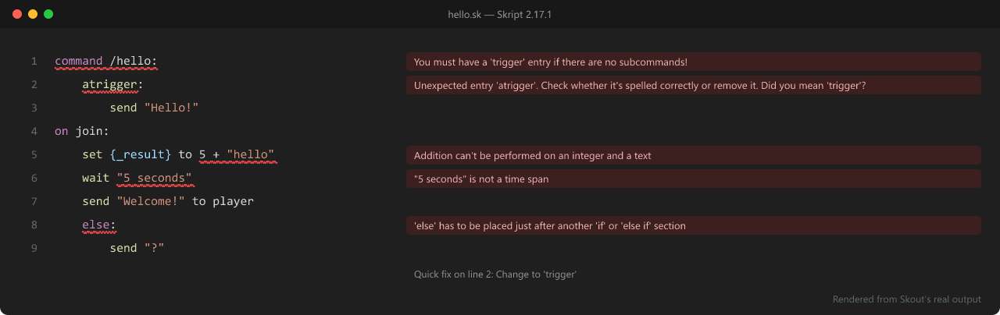

<p align="center">
  
</p>

<p align="center">
  <a href="https://github.com/HighSkai/skout/actions/workflows/ci.yml"></a>
  <a href="https://github.com/HighSkai/skout/releases/latest"></a>
  
  
  <a href="LICENSE"></a>
</p>

**Skout** is a language server and VS Code extension for [Skript](https://github.com/SkriptLang/Skript), the scripting language Minecraft servers use to add features without writing Java. It catches the mistakes `/sk reload` would reject while you are still typing them, and it understands your whole project: functions, options and variables across every script. Completion and docs come from the syntax of *your* server and addons, and before you upgrade Skript or an addon, Skout lists every line the new version breaks.

Most Skript extensions stop at syntax highlighting, or check a line's outer shape and treat everything inside it as text. Skout parses every line down to its sub-expressions with the types Skript gives them, so `set {_x} to 5 + "hello"` is an error in the editor, not a surprise on `/sk reload`. Its rules are ported from Skript's own source, and an error in the editor is an error on your server.

<p align="center">
  
</p>

<!-- GIF: errors-as-you-type.gif. Record typing a line with a missing ':' and watching the squiggle appear and clear. -->

## Features

### Errors before `/sk reload` (0.1)

- **Structure.** Skout reports, as you type:
  - indentation Skript rejects: tabs mixed with spaces, a line deeper than its section allows, a partial indent;
  - a missing `:` on a line that has an indented block under it;
  - unclosed strings, an unescaped `%` inside a string, and unclosed or unmatched `{}`, `()` and `[]`;
  - empty sections;
  - unclosed `###` block comments, and a `#` that silently turns the rest of a value into a comment (`<#ff0000>` in `options:` is the classic).

### Project awareness (0.2)

<p align="center">
  
</p>

Every `.sk` file in the workspace is indexed in the background, open or not.

- **Functions across files.** Go to definition, find all references and hover (signature, the comment above the function, how often it is called) for your functions and for Skript's built-in ones.
- **Cross-file checks:**
  - calls to functions that do not exist, including built-ins newer than your Skript version (`entity()` needs 2.16);
  - calls with the wrong number of arguments, counting optional parameters;
  - duplicate functions across files, following Skript's rules: two functions with the same name are fine since 2.12 if their argument types differ;
  - function headers Skript cannot read;
  - `{@options}` that the script never defines;
  - variables read somewhere but never set, with a "did you mean" for typos (`{_totl}` → `{_total}`). Locals are checked per trigger or function. Named command arguments and function parameters count as set.
- **Variables view.** **Skout: Variables** in the Explorer lists global variables grouped by namespace (`{quest::%uuid%::active::*}` sits under quest › %…% › active) and local variables by file and trigger, each with every place it is set and read. Hovering a variable shows the same.
- **Rename with preview.** Rename a function (definition and every call, in every file) or part of a variable name. Renaming `objective` in `{objective::%player%::done}` renames the whole `{objective::…}` namespace. Changes open in the Refactor Preview first.
- **Workspace symbols.** <kbd>Ctrl</kbd>+<kbd>T</kbd> finds functions, commands and options in any script.
- **Version-aware.** Set `skout.skriptVersion` to your server's version. Skout bundles the built-in syntax of Skript 2.14.3, 2.15.4, 2.16.2 and 2.17.1.
- **Respects how Skript loads scripts.** Scripts and folders starting with `-` are disabled in Skript, so their functions do not count; Skript's own `config.sk` is never read as a script.

### Syntax intelligence (0.3)

<p align="center">
  
</p>

- **Completion that knows where you are.**
  - Events after `on` and at the top level.
  - Effects, conditions and sections at the start of a line.
  - Only conditions after `if`, `else if` and `while`.
  - Expressions later in a line or inside `%…%`.
  - Your functions and the built-in ones.
  - Variables after `{`, options after `{@`, and command entries (`trigger:`, `permission:`, …) directly under a command.

  Each pattern becomes a snippet with a tab stop per `%type%` slot.
- **Docs on hover.** Hover a line to see the syntax it matched: its patterns, description, example, the addon it comes from and the version it arrived in.
- **Typos, with a quick fix.** `sned "hi" to player` gets "Did you mean 'send'?" and a one-click fix. The check only speaks up when changing one word makes the line valid. Lines it cannot place are left alone, so addon syntax Skout does not know about is never flagged. Set `skout.unrecognizedSyntax` to `all` to see every line that matches nothing, with the closest patterns.
- **Your server's syntax, not a guess.** Skout ships Skript's own syntax for 2.14 to 2.17. Add your addons, or your exact Skript build, with `skout.syntaxDumps`, or download them with **Skout: Download Syntax Dump**; see [Use your server's syntax](#use-your-servers-syntax).

### Upgrade checker (0.4)

Run **Skout: Check Upgrade…** and pick what you are upgrading to: a newer Skript (2.14.3 to 2.17.1 are bundled; any other version is downloaded on request), or a newer syntax dump of an addon. Skout checks every script against both versions and puts the results in the Problems panel and in a Markdown report (`.skout/reports/`). Each finding names the file and line and, where the data allows, what to write instead. It finds:

- **Lines that will not load any more.** The line matched a pattern in your version and matches none in the new one, for example `command "…"` once 2.17 made `execute` required. When the same entry still exists, the report shows how it is written now.
- **Syntax that quietly changes meaning.** The exact pattern a line relied on is gone, and only a more general one still fits, so Skript would misread the line.
- **Removed expressions inside a line,** such as 2.17's `last usage date`.
- **Functions that will fail to register,** the classic upgrade surprise:
  - a parameter or return type the new version does not have (`structure type` in 2.16, with the suggestion "It is now called 'tree type'");
  - a new built-in function with the same name and argument types as yours (`entity(uuid)` in 2.16).
- **Calls to built-in functions that no longer exist.**
- **Deprecated syntax.**
- **Behaviour changes from Skript's release notes,** linked: `permission message` is ignored from 2.17, `the executor` means something new in 2.17, and the chat-format placeholders are deprecated in 2.16.

Here is [a real report](docs/sample-upgrade-report.md) for a small script going from Skript 2.15.4 to 2.17.1.

### A language engine (0.5)

Skout 0.5 parses each line the way Skript's parser does: every `%slot%` of a pattern is parsed recursively as an expression, with its type, so problems inside a line are found, not only lines that match nothing.

- **Type errors Skout is sure of:**
  - arithmetic Skript has no operation for: `5 + "hello"`, `now + now`, `2 seconds + 5`, `"a" - {_x}`;
  - a value of the wrong type in a slot: `wait "5 seconds"`, `length of 5`;
  - a list where one value is needed: `{_list::*} + 1`;
  - a function argument of the wrong type: `double("five")` for `double(n: number)`, with Skript's own message.
- **Statements in the wrong place**, with Skript's messages:
  - `else` or `else if` without an `if`, a misplaced `then`, and the rules of multiline `if any:` / `if all:`;
  - `continue` outside a loop, `exit 2 loops` inside one, `loop-value` outside a `loop`;
  - `return` outside a function, in a function without a return type, or after a delay;
  - unreachable code after `stop`, `return` or `continue` (honouring `suppress unreachable code warnings`).
- **Command entries.** An entry Skript does not expect is an error, with a quick fix for a misspelling: `atrigger:` becomes `trigger:`. Also entries given twice, a missing `trigger:` (required before 2.17), cooldown entries without a cooldown, and root-only entries in 2.17 subcommands. `permission message` is shown as deprecated in 2.17.
- **Hover on any part of a line** shows what Skout parsed it as and its type: `length of name of player` · a number.
- **Signature help** for function calls, yours and Skript's built-ins.
- **Formatting.** Re-indents a file with your editor's indent setting and removes trailing whitespace. It only changes whitespace Skript does not read, and leaves a file with indentation errors alone.

<p align="center">
  
</p>

Skout says nothing when it cannot be sure. A part of a line that no known syntax explains, such as an item type or syntax from an addon without a loaded dump, is accepted everywhere, and types are only compared where Skout knows every conversion Skript has (numbers, text, booleans, time spans, dates, vectors). [How Skout works](docs/architecture.md) explains the engine and lists what it does not check yet.

### Your server (0.5)

Open your server folder (or its `plugins/Skript/scripts`), or set `skout.server.folder`, and Skout reads, without starting anything:

- **the Skript version** of the server's Skript jar, so the checks follow the version you run;
- **your addons**, from the `plugin.yml` in each jar. The **Skout** view in the activity bar lists them, with whether their syntax is loaded: lines that use an addon without loaded syntax are not checked, and Skout says so instead of guessing;
- **the syntax dumps your server generated** (`plugins/Skript/docs/docs.json` from `/sk gen-docs`, and SkriptHub Docs Tool output), loaded automatically;
- **the errors Skript printed on `/sk reload`**, from `logs/latest.log`. They appear in the Problems panel as "Skript (server)", on the line that still holds the code Skript quoted. Skout's own checks stay the first line of defence; this is what your real server, with all its addons, said.

### Editor basics

- **Outline.** Events, commands, functions and `options:` entries appear in the Outline view and the breadcrumbs.
- **Folding.** Folding follows the real section structure and `###` block comments.
- **Highlighting.** A small TextMate grammar covers strings with `%expressions%`, variables, `{@options}`, colour codes, comments and structure headers.
- **Fast.** A keystroke in a 2,000-line file is re-parsed and re-indexed in under 10 ms and type-checked again in about 11 ms (only the edited line is re-analysed). The cross-file checks over a 100,000-line project take about 40 ms; scripts that are not open are type-checked in the background.
- **Works in other editors.** The language server has no VS Code dependency; see [Other editors](#other-editors).

### Roadmap

| Milestone | What it adds | Status |
|---|---|---|
| **M1: Foundation** | Parser, highlighting, structural diagnostics | ✅ Released in 0.1 |
| **M2: Project awareness** | Workspace index; go to definition, references and hover; cross-file function, option and variable checks; Variables view; rename with preview | ✅ Released in 0.2 |
| **M3: Syntax intelligence** | Completion and hover docs for events, effects, expressions and conditions, loaded from syntax dumps of *your* server and addons; conservative "unrecognized syntax" hints with quick fixes | ✅ Released in 0.3 |
| **M4: Upgrade checker** | "Skout: Check Upgrade…" compares two versions' syntax and reports every line in your project that the new Skript or addon version breaks, deprecates or changes | ✅ Released in 0.4 |
| **0.5: Language engine** | Recursive, typed parsing of every line; type errors, misplaced statements, command entries; your server's version, addons, generated dumps and reload errors; signature help, formatting | ✅ 0.5 |
| **Next** | Local variable type hints (`using local variable type hints`), event values per event, typed completion, semantic highlighting | Planned |

<!-- GIF: go-to-definition.gif (M2). Record F12 on a function call jumping to another file, then Shift+F12. -->
<!-- GIF: rename-namespace.gif (M2). Record F2 on {objective::…}, the Refactor Preview, and applying it. -->
<!-- GIF: completion.gif (M3). Record typing `se` in a trigger, picking `send %objects%`, and tabbing through the slots. -->
<!-- GIF: upgrade-report.gif (M4). Record Skout: Check Upgrade…, picking Skript 2.17.1, and the report opening next to the Problems panel. -->

## Install

**From a release (VSIX).** Download `skout-<version>.vsix` from the [latest release](https://github.com/HighSkai/skout/releases/latest), then either run **Extensions: Install from VSIX…** from the Command Palette, or:

```sh
code --install-extension skout-0.5.0.vsix
```

**From the Marketplace.** Not published yet. The extension id will be `highskai.skout`.

**From source.** See [CONTRIBUTING.md](CONTRIBUTING.md#getting-started).

Open any `.sk` file and Skout starts. If another Skript extension is installed, both register the `skript` language; disable the other one's diagnostics if you see duplicates.

## Use your server's syntax

Skout knows Skript's own syntax out of the box. To match your server exactly, give it syntax dumps:

- **Your addons, from SkriptHub.** Run **Skout: Download Syntax Dump**, choose *Addons, from SkriptHub*, and tick the addons your server runs (for example SkBee and Skript-Particle). Skout saves them to `.skout/syntax/` and adds that folder to `skout.syntaxDumps`. This is the only time Skout uses the network, and only when you run the command.
- **Your addons, from your own server.** Put the [SkriptHub Docs Tool](https://github.com/SkriptHub/SkriptHubDocsTool) in a copy of your server's `plugins/` folder (its README warns against running it in production) and run `/gendocs`. It writes one file per addon to `plugins/SkriptHubDocsTool/documentation/`. Add that folder to `skout.syntaxDumps`.
- **Your exact Skript build.** Create the folder `plugins/Skript/docs/templates/` (Skript only registers `/sk gen-docs` when it exists), run `/sk gen-docs`, and add `plugins/Skript/docs/docs.json` to `skout.syntaxDumps`. It replaces the bundled Skript syntax. `/sk gen-docs` covers Skript only, not addons.

When Skout knows your server folder (see [Your server](#your-server-05)), the dumps in `plugins/Skript/docs/` and `plugins/SkriptHubDocsTool/documentation/` are loaded without being listed.

Addon functions loaded this way are known to the function checks too, so `skout.knownFunctions` is no longer needed for them. **Skout: Reload Syntax Dumps** picks up changed files.

## Settings

Every diagnostic category can be switched off.

| Setting | Default | What it controls |
|---|---|---|
| `skout.skriptVersion` | `""` | Your server's Skript version, e.g. `2.16.2`. Version-dependent rules follow it. Empty means the newest bundled version (2.17.1) |
| `skout.addonVersions` | `{}` | The addon versions your server runs, e.g. `{ "SkBee": "3.11.0" }`, used to label upgrade reports |
| `skout.knownFunctions` | `[]` | Functions provided by addons whose syntax is not loaded, so calls to them are not reported as undefined |
| `skout.syntaxDumps` | `[]` | Syntax dump files or folders (Skript's `docs.json`, SkriptHub Docs Tool output, downloaded dumps), absolute or relative to the workspace |
| `skout.server.folder` | `""` | Your server folder (with `plugins/Skript` in it). Empty: found from the workspace. Skout reads its Skript version, addons, generated dumps and log |
| `skout.server.readLog` | `true` | Show the errors Skript printed in `logs/latest.log` as "Skript (server)" problems |
| `skout.unrecognizedSyntax` | `"typos"` | `typos`: report a line only when one changed word makes it valid. `all`: also report every unmatched line, as information. `off` |
| `skout.diagnostics.indentation` | `true` | Mixed tabs and spaces, wrong indentation depth, and (as information) a file mixing indent styles between structures |
| `skout.diagnostics.missingColon` | `true` | A line followed by an indented block that does not end with `:` |
| `skout.diagnostics.unclosed` | `true` | Unclosed quotes, `%` in strings, `{}`, `()` and `[]` |
| `skout.diagnostics.emptySection` | `true` | Sections with nothing indented under them |
| `skout.diagnostics.comments` | `true` | Unclosed `###` block comments and accidental `#` comments |
| `skout.diagnostics.undefinedFunction` | `true` | Calls to functions that are neither in the workspace nor built into Skript |
| `skout.diagnostics.argumentCount` | `true` | Calls to your functions with too many or too few arguments |
| `skout.diagnostics.duplicateFunction` | `true` | Functions defined twice with the same argument types, or clashing with a built-in |
| `skout.diagnostics.functionSignature` | `true` | Function headers Skript cannot read |
| `skout.diagnostics.unknownOption` | `true` | `{@options}` the script does not define |
| `skout.diagnostics.unsetVariable` | `true` | Variables read but never set |
| `skout.diagnostics.types` | `true` | Sub-expressions of a type Skript certainly rejects |
| `skout.diagnostics.context` | `true` | Statements in the wrong place: `else` without `if`, `continue` outside a loop, `return` outside a function, unreachable code |
| `skout.diagnostics.entries` | `true` | Unexpected, repeated or missing `command` entries |
| `skout.trace.server` | `"off"` | Logs the messages between VS Code and the server to the **Skout** output channel |

## Diagnostics reference

| Code | Severity | Meaning |
|---|---|---|
| `indent-mixed` | Error | The indentation mixes tabs and spaces |
| `indent-unexpected` | Error | The line is indented deeper than its section allows, or by part of an indent unit |
| `indent-style` | Information | Structures in one file use different indents (Skript allows it, but it is easy to break) |
| `missing-colon` | Error | A section header like `if …` or `trigger` is missing its `:` |
| `unclosed-string` | Error | A `"` with no closing quote on the line |
| `unclosed-percent` | Error | An unescaped `%` in a string (write `%%` for a literal percent sign) |
| `unclosed-bracket` / `unmatched-bracket` | Error (`[]`: Warning) | A `{`, `(` or `[` is never closed, or a closer has no opener |
| `empty-section` | Warning | Nothing is indented under a line ending in `:` |
| `unclosed-block-comment` | Error | A `###` block comment is never closed |
| `accidental-comment` | Warning | A `#` right after other text starts a comment; write `##` for a literal `#` |
| `undefined-function` | Warning (Error for a built-in newer than your version) | No function with this name in the workspace or in Skript |
| `argument-count` | Error | No definition of the function takes that many arguments |
| `duplicate-function` | Error | Another function has the same name and argument types (same name only, before 2.12) |
| `invalid-function` | Error | Skript cannot read the function header; the message is Skript's own |
| `unknown-option` | Error | `undefined option {@name}`, as Skript reports it |
| `unset-variable` | Warning | The variable is read but never set where it could be |
| `unrecognized-syntax` | Warning (Information in `all` mode) | The line matches no known syntax; with a quick fix when one word is misspelled |
| `invalid-operation` | Error | Arithmetic Skript has no operation for: `5 + "hello"` |
| `type-mismatch` | Error | A value of a type the slot cannot take: `wait "5 seconds"` |
| `single-value` | Error | A list variable where one value is needed |
| `argument-type` | Error | A function argument of the wrong type, with Skript's message |
| `misplaced-conditional` | Error | `else`, `else if` or `then` in the wrong place, or a multiline `if` that breaks its rules |
| `misplaced-statement` | Error | `continue`, `exit`, `return` or `loop-value` where Skript does not allow it |
| `unreachable-code` | Warning | A statement after one that stops execution |
| `unknown-entry` | Error | A `command` entry Skript does not expect, with a quick fix for a misspelling |
| `missing-entry` / `command-entries` | Error / Warning | A required entry is missing, or entries that only make sense together |
| `deprecated-entry` | Hint (struck through) | An entry Skript still accepts but ignores |
| `skript-reported` | As Skript said | An error or warning Skript printed for this line on your server (source "Skript (server)") |
| `upgrade-*` | Varies | Findings of **Skout: Check Upgrade…**, kept apart from the live diagnostics; **Skout: Clear Upgrade Results** removes them |

### How Skout knows what Skript accepts

Skout does not guess at Skript's rules; it ports them from Skript's source:

- Comments follow `Node#splitLine`: `###` alone on a line toggles a block comment, `##` outside a string is a literal `#`, and `#` inside a string never starts a comment.
- Indentation follows `SectionNode#load_i`: the first indented line of each top-level structure sets that structure's indent unit, so one event may use tabs and the next four spaces.
- `{@options}` are substituted as plain text before Skript parses a line, so Skout trusts option values that contain brackets or quotes.
- Function headers, parameters and calls follow `StructFunction`, `FunctionParser` and `FunctionArgumentParser`, including the version differences: overloading since 2.12, `->` return types and named arguments since 2.14.
- Variables are case-insensitive, as in Skript's default config. A dynamic part such as `%player%` may hold any value, so Skout only warns when no write could possibly match.
- Argument counts are not checked for built-in functions, because Skript's documentation lists one signature per function and leaves out overloads (it documents `vector(n)` but not `vector(x, y, z)`).
- The upgrade checker compares lines, not documentation ids: Skript renamed most ids between 2.13 and 2.16 (`EvtJoin` became `join`), so comparing ids would report hundreds of removals that are not. It must report nothing on Skript's own 2.17.1 tests when they are checked as an upgrade from 2.16.2.
- Syntax patterns are matched with a port of Skript's own pattern compiler and matchers (`PatternCompiler`, `LiteralPatternElement`, `TypePatternElement`), and since 0.5 each `%slot%` is parsed recursively like `SkriptParser#parseSingleExpr`. Type rules come from `DefaultConverters` and `DefaultOperations`, type names from `default.lang`, and context rules from `SecConditional`, `EffContinue`, `EffExit`, `EffReturn`, `ExprLoopValue` and `ScriptLoader`.

Every change is checked against all 587 scripts in Skript's own repository: Skout must report no errors on any of them, except the lines Skript's tests expect to fail and calls to Skript's test-only functions, and no typo warnings at all. For misplaced statements the test is stricter: Skout must report exactly the four errors Skript's own tests expect, and nothing else.

## Other editors

The server speaks plain LSP over stdio, IPC or a socket:

```sh
node dist/server.js --stdio
```

Point your editor's LSP client at that command for `*.sk` files; settings use the same `skout.*` keys. Clients without `workspace/configuration` can pass `{ "settings": { "diagnostics": { … } } }` as initialization options. A Neovim example:

```lua
vim.filetype.add({ extension = { sk = 'skript' } })
vim.lsp.config('skout', {
  cmd = { 'node', '/path/to/skout/dist/server.js', '--stdio' },
  filetypes = { 'skript' },
})
vim.lsp.enable('skout')
```

## Contributing

Bug reports, especially false positives, are very welcome. A false positive is a diagnostic on a line that Skript accepts. [CONTRIBUTING.md](CONTRIBUTING.md) covers the setup, the tests and the rules for adding diagnostics.

## Acknowledgements

- [SkriptLang/Skript](https://github.com/SkriptLang/Skript), whose config parser defines the rules Skout enforces, and whose test scripts are Skout's stress-test corpus.
- [SkriptLang/skript-docs](https://github.com/SkriptLang/skript-docs): the bundled syntax in `dumps/` is normalized from Skript's published `docs.json` (GPL-3.0).
- [SkriptHub](https://skripthub.net) and its [Docs Tool](https://github.com/SkriptHub/SkriptHubDocsTool), the sources of addon syntax.
- The existing Skript editor tools ([IntelliSkript](https://github.com/JohnHeikens/IntelliSkript), [Sk-VSC](https://github.com/AyhamAl-Ali/Sk-VSC), [r4tsk](https://github.com/RATR2/r4tsk), [SkriptZed](https://github.com/DaisyCatTs/SkriptZed)) for showing what Skript developers want from an editor.

## License

Skout is free software under the [GNU General Public License v3.0](LICENSE) (GPL-3.0-only), the same license as Skript. You may use, change and share it; if you distribute a modified version, it must stay under the GPL with its source available.
